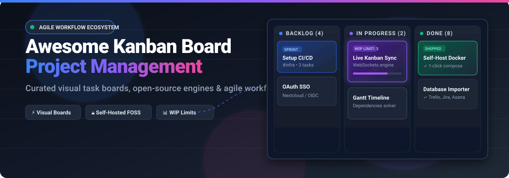

# 📋 Awesome Kanban Board Project Management

<p align="center">
  
</p>

<p align="center">
  <a href="https://github.com/ishandutta2007/Awesome-Awesome-Awesome"></a>
  <a href="https://discord.gg/jc4xtF58Ve"></a>
  <a href="https://awesome.re"></a>
  <a href="https://github.com/ishandutta2007/Awesome-Kanban-Board-Project-Management"></a>
  <a href="http://creativecommons.org/publicdomain/zero/1.0/"></a>
  <a href="https://github.com/ishandutta2007"></a>
</p>

> 📌 A curated directory of the best **Kanban board project management** software, visual task management platforms, agile workflow tools, and self-hosted open-source Kanban alternatives.

🕒 **Last updated: November 2026**

---

## 📑 Table of Contents

- [🌐 Sector Overview & Market Dynamics](#-sector-overview--market-dynamics)
- [☁️ SaaS & Hosted Kanban Platforms](#️-saas--hosted-kanban-platforms)
- [💻 Open-Source GitHub Projects](#-open-source-github-projects)
- [📐 Comparison & Architecture Guidelines](#-comparison--architecture-guidelines)
- [🤝 How to Contribute](#-how-to-contribute)
- [⭐ Star History](#-star-history)
- [💖 Support](#-support)
- [⚖️ Disclaimer](#-disclaimer)

---

## 🌐 Sector Overview & Market Dynamics

📊 The global Kanban and visual project management software sector is estimated at **$1.41 Billion to $1.88 Billion in 2025/2026**, projected to grow at a Compound Annual Growth Rate (CAGR) of **9.0% to 16.8%** toward **$3.4+ Billion** over the next decade.

🧩 The sector is **moderately fragmented**: while a handful of dominant enterprise conglomerates and public market titans (such as Atlassian/Trello, monday.com, and Asana) control the lion's share of enterprise-wide digital workplace spend, it is not a pure "winner-take-all" market. High switching costs, varied team paradigms (e.g., developer-centric agile vs. marketing creative pipelines), and data sovereignty requirements have created durable, thriving market segments for focused multi-view collaboration tools (ClickUp, Miro), specialized lean workflow engines (Kanban Tool, SwiftKanban), and privacy-first self-hosted open-source platforms.

---

## ☁️ SaaS & Hosted Kanban Platforms

Below is a breakdown of top commercial SaaS Kanban and visual work management platforms, sorted descending by company size (market valuation or estimated enterprise scale).

| Platform | Company Valuation / Revenue Scale | Starting Tier Price | Free Tier Limits / Policy | Key Highlights & Architecture Focus |
| :--- | :--- | :--- | :--- | :--- |
| **[Trello](https://trello.com/)** | **~$48B – $55B** *(Atlassian public market cap; acquired Trello for $425M)* | **$5.00** / user / month (Standard, billed annually) or $6.00 billed monthly | **Free Forever**: Max 10 boards per workspace, up to 10 collaborators per workspace, 250 automation runs/month, 10 MB file attachment cap; unlimited cards & power-ups. | 🃏 The canonical visual Kanban board; lists, cards, and Butler workflow automation. |
| **[Monday.com](https://monday.com/)** | **~$3.5B – $7.6B** *(Public NASDAQ: MNDY; ~$1.23B FY2025 revenue)* | **$9.00** / seat / month (Basic, billed annually; **3-seat min = $27/month**) | **Free Forever**: Max 2 team members, up to 3 boards total, 200 items hard cap, 500 MB storage; excludes automations, integrations, and Gantt views. | 📊 Highly customizable Work OS with board, timeline, and dashboard views with visual automations. |
| **[ClickUp](https://clickup.com/)** | **$4.0B** *(Private valuation, Series C)* | **$7.00** / user / month (Unlimited, billed annually) or $10.00 billed monthly | **Free Forever**: Unlimited tasks & unlimited members, 100 MB total file storage cap, 100 automation runs/month, 5 Spaces, and 40 Lists per Space. | 🎯 "One app to replace them all"; combines Kanban boards with docs, wikis, goals, and chat. |
| **[Asana](https://asana.com/)** | **~$2.4B – $3.2B** *(Public NYSE: ASAN; ~$790M revenue)* | **$10.99** / user / month (Starter, billed annually) or $13.49 billed monthly | **Free Forever (Personal)**: Up to 10 teammates, unlimited tasks and projects, 100 MB file upload cap, list/board/calendar views; excludes workflow rules, timeline & custom fields. | 🏢 Enterprise work management platform with board view alongside list, timeline, and portfolio views. |
| **[Wrike](https://www.wrike.com/)** | **$2.25B** *(Acquisition valuation by Citrix/STG)* | **$10.00** / user / month (Team, billed annually; 2–15 users) | **Free Forever**: Unlimited users, 2 GB total account cloud storage cap, 200 active task/subtask hard limit; standard board & table views only. | 📈 Enterprise project management platform with custom Kanban workflows, request forms, and resource planning. |
| **[Miro](https://miro.com/)** | **~$1.35B – $1.79B** *(Enterprise transaction valuation; peak $17.5B)* | **$8.00** / member / month (Starter, billed annually) or $10.00 billed monthly | **Free Forever**: Max 3 active editable boards (subsequent boards turn view-only), unlimited workspace members, 10 Miro AI credits/month; shared board visibility. | 🎨 Infinite visual whiteboard canvas with interactive Kanban board widgets, diagrams, and sprint workshops. |
| **[MeisterTask](https://www.meistertask.com/)** | **~$34M** *(Annual revenue run-rate, Meister)* | **$13.00** / user / month (Pro, billed annually) or $14.50 billed monthly | **Free Forever (Basic)**: Up to 3 active projects, unlimited tasks and collaborators, 20 MB file attachment cap, 5 notes, 7-day version history; excludes automations. | ✨ Clean, distraction-free visual task boards with native time tracking and integrations. |
| **[SwiftKanban](https://www.digite.com/)** | **~$10M** *(Annual revenue run-rate, Digité / NimbleWork)* | **$7.00** / user / month (Group tier, up to 50 users) | **Free Forever**: Up to 3 users, max 2 boards, 5 standard & 5 custom card types; 30-day free trial offered for Enterprise features. | 🏃 Enterprise Kanban and Scrumban platform with cumulative flow diagrams and portfolio tracking. |
| **[Kanban Tool](https://kanbantool.com/)** | **<$5M** *(Bootstrapped, Sofpro)* | **$6.00** / user / month (Team tier, billed monthly) | **Free Forever**: Max 2 users, max 2 boards, zero file attachments supported, standard analytics; excludes time tracking and automation widgets. | ⏱️ Dedicated visual lean Kanban board platform with swimlanes, WIP limits, and time tracking. |
| **[Kanbanchi](https://www.kanbanchi.com/)** | **~$1.1M** *(Annual revenue run-rate)* | **$3.97** / user / month (Essential, billed annually) | **Free Forever (Demo)**: Max 36 cards per board (boards exceeding 36 cards switch to read-only mode); 14-day free trial of Enterprise features upon signup. | 📁 Native Google Workspace Kanban board integrating directly into Google Drive and Google Calendar. |

---

## 💻 Open-Source GitHub Projects

🛡️ Self-hosted and open-source Kanban repositories provide full data sovereignty, zero per-seat licensing fees, and local database control. Sorted descending by GitHub stargazers count:

| Repository & Stargazers | License | Core Technology Stack | Primary Architecture & Fit |
| :--- | :--- | :--- | :--- |
| **[Plane](https://github.com/makeplane/plane)** [](https://github.com/makeplane/plane/stargazers) | AGPL-3.0 | Python / Django, TypeScript, Next.js, PostgreSQL | 🚀 Modern Jira and Linear alternative with Kanban boards, sprint cycles, issue modules, and markdown pages. Rapidly moving release cycles. |
| **[Focalboard](https://github.com/mattermost-community/focalboard)** [](https://github.com/mattermost-community/focalboard/stargazers) | AGPL-3.0 / Apache-2.0 | Go, TypeScript, React, PostgreSQL / SQLite | 📌 Multipurpose task board alternative to Trello and Notion with Kanban, table, and calendar views. **Note**: Standalone app is unmaintained; actively maintained as Mattermost Boards plugin. |
| **[Wekan](https://github.com/wekan/wekan)** [](https://github.com/wekan/wekan/stargazers) | MIT | JavaScript / Meteor, Node.js, MongoDB | 📋 Canonical direct open-source Trello alternative with real-time boards, swimlanes, WIP limits, CSV/Trello importers, and zero telemetry. Requires MongoDB and regular backup discipline. |
| **[OpenProject](https://github.com/opf/openproject)** [](https://github.com/opf/openproject/stargazers) | GPL-3.0 | Ruby on Rails, Angular, PostgreSQL | 🏢 Enterprise-grade open-source project management platform featuring Agile Kanban boards, Gantt charts, roadmaps, and bug tracking. |
| **[Planka](https://github.com/plankanban/planka)** [](https://github.com/plankanban/planka/stargazers) | AGPL-3.0 | Node.js, React, Redux, PostgreSQL | ⚡ Real-time elegant kanban board for workgroups with custom backgrounds, card attachments, markdown support, and timer tracking. Lightweight Docker deployment. |
| **[Leantime](https://github.com/leantime/leantime)** [](https://github.com/leantime/leantime/stargazers) | AGPL-3.0 | PHP, JavaScript, MySQL / MariaDB | 💡 Goal-oriented project management system designed for non-project managers, combining Kanban boards with Lean canvas, idea boards, and milestones. |
| **[Kanboard](https://github.com/kanboard/kanboard)** [](https://github.com/kanboard/kanboard/stargazers) | MIT | PHP, SQLite / MySQL / PostgreSQL | 📦 Minimalist, lightning-fast self-hosted Kanban board with automatic workflow actions, swimlanes, WIP limits, and subtasks. Extremely stable and resource-friendly. |
| **[Kaneo](https://github.com/usekaneo/kaneo)** [](https://github.com/usekaneo/kaneo/stargazers) | AGPL-3.0 | TypeScript, React, Node.js, SQLite / PostgreSQL | ⚡ Modern, opinionated task tracking software with Kanban boards, interactive Gantt charts, and GitHub integration that stays out of your way. |
| **[Fizzy](https://github.com/basecamp/fizzy)** [](https://github.com/basecamp/fizzy/stargazers) | MIT | Ruby on Rails, Hotwire / Turbo, SQLite | 🧼 Refreshingly straightforward Kanban board by 37signals (Basecamp) focused on simplicity, clarity, and zero-bloat task cards. |
| **[Vikunja](https://github.com/go-vikunja/vikunja)** [](https://github.com/go-vikunja/vikunja/stargazers) | AGPL-3.0 | Go, TypeScript, Vue.js, SQLite / MySQL / PostgreSQL | 🗂️ Multi-view task management application providing Kanban, List, Gantt, and Table views in a single self-contained binary or Docker container. |
| **[Taskcafe](https://github.com/JordanKnott/taskcafe)** [](https://github.com/JordanKnott/taskcafe/stargazers) | MIT | Go, React, TypeScript, GraphQL, PostgreSQL | ☕ Open-source project management tool with Kanban boards, task assignments, checklist items, and project timelines. |
| **[Nullboard](https://github.com/apankrat/nullboard)** [](https://github.com/apankrat/nullboard/stargazers) | BSD-2-Clause | Vanilla JavaScript, HTML5, LocalStorage | 🪶 Zero-dependency, single-file offline minimalist Kanban dashboard focused on rapid note-taking, speed, and local privacy. |
| **[Restyaboard](https://github.com/RestyaPlatform/board)** [](https://github.com/RestyaPlatform/board/stargazers) | OSL-3.0 | PHP, AngularJS, PostgreSQL | 📊 Feature-complete Trello alternative with multiple layout views, Gantt integration, calendar, chat, and built-in time reporting. |
| **[Nextcloud Deck](https://github.com/nextcloud/deck)** [](https://github.com/nextcloud/deck/stargazers) | AGPL-3.0 | PHP, Vue.js (Nextcloud App) | ☁️ Native Kanban task management app integrated directly into the Nextcloud cloud suite with attachments, notifications, and mobile app sync. |
| **[Taiga](https://github.com/kaleidos-ventures/taiga)** [](https://github.com/kaleidos-ventures/taiga/stargazers) | MPL-2.0 | Python / Django, AngularJS, PostgreSQL | 🥋 Agile project management platform tailored for cross-functional agile development teams using Scrum and Kanban. |

---

## 📐 Comparison & Architecture Guidelines

When selecting a Kanban platform for your team or infrastructure, evaluate based on deployment architecture and operational complexity:

```
                            ┌───────────────────────────────────────────────┐
                            │    Choose Your Kanban Deployment Pattern      │
                            └───────────────────────┬───────────────────────┘
                                                    │
                   ┌────────────────────────────────┴────────────────────────────────┐
                   ▼                                                                 ▼
        ┌───────────────────────┐                                         ┌───────────────────────┐
        │   Commercial SaaS     │                                         │ Self-Hosted / FOSS    │
        └──────────┬────────────┘                                         └──────────┬────────────┘
                   │                                                                 │
      ┌────────────┴────────────┐                                       ┌────────────┴────────────┐
      ▼                         ▼                                       ▼                         ▼
┌─────────────┐           ┌─────────────┐                         ┌─────────────┐           ┌─────────────┐
│ Fast/Simple │           │ All-in-One  │                         │ Minimalist  │           │ Modern/Agile│
│ (Trello,    │           │ (ClickUp,   │                         │ (Kanboard,  │           │ (Plane,     │
│  Meister)   │           │  Monday)    │                         │  Vikunja)   │           │  Wekan)     │
└─────────────┘           └─────────────┘                         └─────────────┘           └─────────────┘
```

1. **For Pure Visual Simplicity & Speed**: [Trello](https://trello.com/) or [Planka](https://github.com/plankanban/planka) deliver low-friction boards without overwhelming menus.
2. **For Complete Product Lifecycle & Sprint Planning**: [Plane](https://github.com/makeplane/plane) or [Monday.com](https://monday.com/) provide full cycle management, issue tracking, and cross-team roadmapping.
3. **For Low-Resource Single-Server Self-Hosting**: [Kanboard](https://github.com/kanboard/kanboard) (PHP/SQLite) and [Vikunja](https://github.com/go-vikunja/vikunja) (Go single binary) run efficiently on 512MB RAM VPS instances.
4. **For Established Enterprise Ecosystems**: [Nextcloud Deck](https://github.com/nextcloud/deck) (if already self-hosting Nextcloud) or [Kanbanchi](https://www.kanbanchi.com/) (if tied to Google Workspace).

---

## 🤝 How to Contribute

1. 🍴 Fork this repository.
2. 📝 Add your suggested SaaS tool or open-source Kanban project in alphabetical or star-ranked order.
3. 🏷️ Ensure exact starting pricing, free plan restrictions, and proper GitHub star badges (`style=social&color=white`) linking to the stargazers page.
4. 🚀 Submit a Pull Request with a clear summary of your changes.

---

## ⭐ Star History

[](https://star-history.dera.page/#ishandutta2007/Awesome-Kanban-Board-Project-Management&type=date&legend=top-left)

---

## 💖 Support

Thank you for visiting this repository! If you find this curated list of Kanban board tools helpful, please consider:
- ⭐ **Starring** the repository to show support and boost visibility for other developers and teams.
- 🍴 **Forking** the repo and submitting pull requests with new tools, updates, or improvements.
- 📢 **Sharing** this guide with colleagues, project managers, and developer communities.
- ☕ **Buying a coffee / sponsoring** the author via the [GitHub Sponsors Dashboard](https://github.com/sponsors/ishandutta2007) to help support ongoing maintenance and curation!

---

## ⚖️ Disclaimer

- ℹ️ This list is community-curated for architectural comparison and research purposes.
- 🏢 All brand names, logos, and trademarks belong to their respective owners.
- 💲 Pricing, free tier thresholds, and feature limits are subject to change by vendors; always check official vendor pricing pages before procurement.
